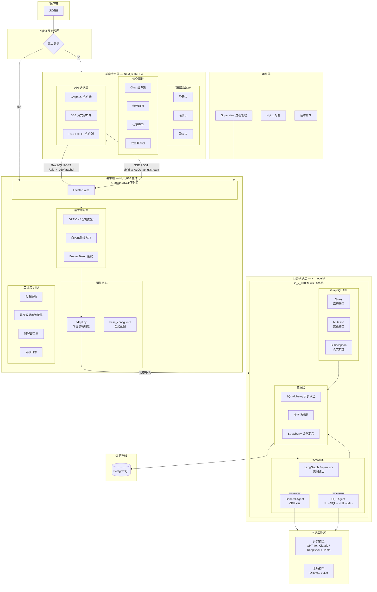
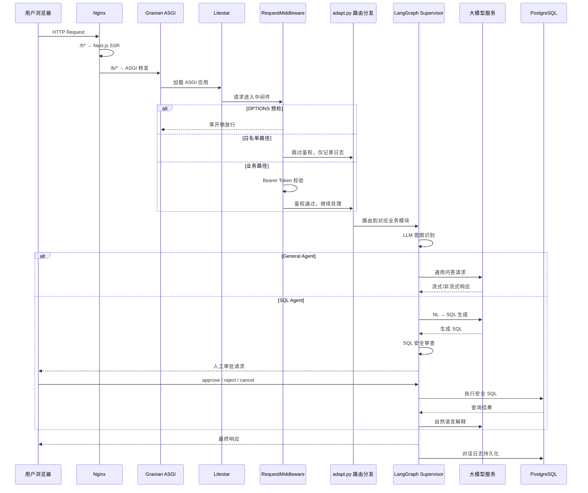

# id_x_010（结构体-010）· 通用计算引擎


> 全栈智能计算引擎 · 插件化架构 · Apple Design 设计范式

---

## ⚫ 1. 项目简介

**Slogan**：基于 LangGraph 多智能体编排的全栈智能问答与自然语言查询引擎。

**Description**：

`id_x_010` 是 `id_x_000` 引擎体系下的试验体（Trial Body），整体由三层构成：

- **引擎层**：`id_x_010` 主体，`main.py` + `adapt.py` 动态加载业务模块，自身不含业务逻辑。
- **业务模块层**：`x_models/id_x_010` 智能问答系统，提供 LangGraph 编排、GraphQL API 与对话上下文管理。
- **前端应用层**：`web/` Next.js 16 单页应用（Single Page Application, SPA），遵循 Apple 人机界面指南（Human Interface Guidelines, HIG），提供服务器推送事件（Server-Sent Events, SSE）流式对话交互。

其中业务模块采用分层解耦设计：Quart / Litestar 网关 → SemanticRouter 语义路由 → LangGraph StateGraph 编排（General / SQL Agent）→ 模型切换器（外部 EXTERNAL API 或本地 Ollama / vLLM）→ SSE 流式响应回写前端，并将对话日志持久化到 PostgreSQL。所有 API 通过 `/010/graphql` 暴露，模型表仅使用基础类型（Integer / String / Text / DateTime / JSON / Boolean），不依赖 pgcrypto 或 pgvector。

**适用场景**：企业内部知识问答、面向非技术人员的自然语言数据库查询、多模型对比评估、生产级大语言模型（Large Language Model, LLM）应用落地参考实现。

**与同类项目相比的优势**：引擎与业务解耦的插件化架构、SQL 生成的人工审批安全闭环、全程异步链路、生产就绪的部署脚手架、Apple Design 级视觉品质。

---

## ⚫ 2. 核心特性

- **LangGraph 状态编排** —— 基于 `StateGraph` 构建 Supervisor（主管）+ General Agent（通用代理）+ SQL Agent（SQL 代理），支持多轮上下文与自我修正。
- **SemanticRouter 语义路由** —— 向量相似度匹配意图，告别脆弱的条件分支路由。
- **本地 / 外部模型热切换** —— 前端传参动态实例化模型对象（Ollama / vLLM 本地模型与 SiliconFlow / OpenRouter 等外部大模型）。
- **流式响应（SSE）** —— 思考过程、推理内容、完成事件分片下发，前端打字机效果。
- **对话日志持久化** —— `conversation_logs` 表保存 `user_query` / `model_response` / `thinking_process` / `intent` / 元数据。
- **SQL 安全审批闭环** —— 自动检测危险操作 + 人工 approve / reject / cancel，reject 后自动重新生成。

---

## ⚫ 3. 项目亮点

1. **全链路异步架构**
   — Granian（Rust ASGI）+ Litestar（异步框架）+ async SQLAlchemy + asyncpg，从网络 I/O 到数据库访问无同步阻塞，单进程事件循环利用率高，单机可支撑 50+ 并发用户。

2. **LangGraph 状态机编排**
   — 区别于简单的条件分支路由，采用 StateGraph 驱动多 Agent 协同，支持意图识别 → 分发 → 执行 → 审批 → 修正的完整状态流转，可观测、可调试、可扩展。

3. **SQL 安全审批闭环**
   — 自然语言生成 SQL 后，经过安全审查（危险模式检测）+ 人工审批（approve / reject / cancel），reject 后自动重新生成，形成安全修正闭环，兼顾便捷性与数据安全。

4. **插件式业务热挂载**
   — 引擎通过 `adapt.py` 读取配置表，动态导入业务模块并注册路由。新增业务模块只需实现 `register_routers()` 接口并在 TOML 中声明，零改动引擎代码。

5. **Apple Design 暗色模式**
   — 前端全量适配 Apple HIG 设计语言，CSS 变量双主题 + Fluent UI 映射 + 磨砂玻璃，暗色模式非简单反色而是独立设计的色彩层级，视觉品质对标 Apple 官网。

6. **SSE 流式对话 + AbortController**
   — 前端以 SSE 解析 GraphQL Subscription 流，支持 AbortController 随时中断响应；思考过程 / 内容 / SQL 审批三类流式事件统一处理，对话体验流畅且可控。

7. **凭据加密管理**
   — 数据库密码、API Key 等敏感信息以异或（XOR）+ Base64 加密后存入环境变量，运行时动态解密注入应用配置，杜绝明文泄露。

8. **中间件分层短路**
   — OPTIONS 预检零开销放行，白名单路径跳过鉴权，仅业务路径执行完整鉴权链路，减少不必要的对象构造与 CPU 开销。

---

## ⚫ 4. 技术栈

表 4-1　项目技术栈一览

| 分类 | 名称 | 版本 | 用途 |
| --- | --- | --- | --- |
| 编程语言 | Python | 3.12 | 引擎层与业务插件运行时 |
| 编程语言 | TypeScript / React | React 19 | 前端 SPA 构建 |
| 后端框架 | Litestar | 2.x | ASGI 异步 Web 框架 |
| 后端框架 | Granian | 最新稳定版 | Rust ASGI 服务器 |
| 前端框架 | Next.js | 16 | App Router 前端框架 |
| 前端 UI | Fluent UI + Framer Motion + Tailwind CSS | 最新稳定版 | 组件库与动画 / 原子化样式 |
| API 规范 | Strawberry GraphQL | 0.x | GraphQL Schema + Subscription（SSE 流式） |
| ORM / 驱动 | SQLAlchemy 2.x + asyncpg / psycopg2 | SQLAlchemy 2.x | 异步数据库会话与连接池 |
| 数据库 | PostgreSQL | ≥ 14 | 业务库（对话日志 / 用户 / 令牌 / 模型配置） |
| 向量库 | PgVector | 可选 | 语义路由向量索引 |
| LLM 编排 | LangGraph / LangChain / langchain-openai / semantic-router | 最新稳定版 | 多智能体编排与意图路由 |
| 外部模型 | SiliconFlow / OpenRouter 等 | OpenAI 兼容 API | 通过 EXTERNAL API 调用外部大模型 |
| 本地模型 | Ollama / vLLM | 最新稳定版 | 本地大模型推理服务 |
| 反向代理 | Nginx（HTTPS 终止）+ HAProxy | 最新稳定版 | 反向代理与负载均衡 |

---

## ⚫ 5. 整体架构图



图 5-1　系统整体架构（自上至下分层）

---

## ⚫ 6. 请求流转图



图 6-1　一次完整请求的生命周期

核心交互流程文字说明：

1. **接收用户请求**：Litestar 监听 `0.0.0.0:18080`。
2. **网关接入**：GraphQL 接口接收请求。
3. **意图识别**：Semantic Router 分析语义，将请求转发给 General / SQL Agent。
4. **模型推理**：Agent 构造 Prompt，通过模型切换器调用不同大模型，并获取思考过程与反馈结果。
5. **响应返回**：结果经由 SSE 流式返回前端展示。

---

## ⚫ 7. 目录结构

```text
x_models/id_x_010/
├── docs/                              # 设计文档
│   ├── intent-recognition-analysis.md
│   ├── 实现要求.md
│   └── 架构描述.md
├── ops/                               # 运维与部署
│   ├── id_x_010.service               # 后端 systemd 服务
│   ├── id_x_010_web.service           # 前端 systemd 服务
│   ├── id_x_010[HAProxy].conf         # HAProxy 配置
│   ├── id_x_010[Nginx].conf           # Nginx 配置（HTTPS 终止 + 反代前端 3000 / 后端 18080）
│   └── init.sql                       # 业务库 DDL（6 张表 + 触发器）
├── src/
│   ├── agents/
│   │   ├── x_general_agent.py         # 通用代理：调用大模型
│   │   ├── x_langgraph_supervisor.py  # LangGraph 编排器（StateGraph）
│   │   └── x_sql_agent.py             # SQL 代理（Schema 检索 → SQL 生成 → 执行 → 自我修正）
│   ├── controllers/
│   │   └── x_controllers.py           # GraphQL Schema + Resolvers（Query / Mutation / Subscription）
│   ├── graphql/                       # GraphQL 扩展（预留）
│   │   └── __init__.py
│   ├── models/
│   │   └── x_models.py                # 数据库模型（users / conversation_logs / external_models / local_models / ...）
│   ├── schemas/
│   │   └── x_schemas.py               # GraphQL 输入/输出类型定义
│   ├── views/
│   │   └── x_views.py                 # 数据保存逻辑（save_conversation_log / 上下文合并等）
│   └── __init__.py
├── web/                               # Next.js 前端
│   ├── package.json                   # Next 16 + React 19 + Fluent UI + Framer Motion + Tailwind
│   ├── next.config.ts
│   ├── tsconfig.json
│   ├── postcss.config.mjs
│   ├── Dockerfile
│   ├── public/                        # 静态资源
│   └── src/
│       ├── api/                       # 客户端 API 封装
│       │   ├── graphql.ts
│       │   ├── http.ts
│       │   ├── streamChat.ts          # SSE 流式聊天客户端
│       │   └── user.ts
│       ├── app/                       # Next.js App Router
│       │   ├── f/
│       │   │   ├── forgot-password/page.tsx
│       │   │   ├── home/page.tsx
│       │   │   ├── login/page.tsx
│       │   │   └── register/page.tsx
│       │   ├── layout.tsx
│       │   └── page.tsx
│       ├── assets/                    # 全局样式
│       ├── components/                # 业务组件
│       │   ├── AnimatedCharacters/
│       │   ├── ForgotPasswordForm/
│       │   ├── LoginForm/
│       │   ├── RegisterForm/
│       │   ├── chat/                  # 聊天界面组件
│       │   │   ├── AgentSelector.tsx
│       │   │   ├── CenterHero.tsx
│       │   │   ├── ChatHeader.tsx
│       │   │   ├── ChatMessage.tsx
│       │   │   ├── DatabaseSelector.tsx
│       │   │   ├── MessageInput.tsx
│       │   │   ├── MessageList.tsx
│       │   │   ├── SqlApprovalPanel.tsx
│       │   │   └── ThinkingDots.tsx
│       │   ├── ui/LoadingDots.tsx
│       │   ├── AuthGuard.tsx
│       │   ├── ForgotPasswordPage.tsx
│       │   ├── LeftPanel.tsx
│       │   ├── LoginPage.tsx
│       │   ├── RegisterPage.tsx
│       │   └── ThemeToggle.tsx
│       ├── context/ThemeContext.tsx   # 主题上下文
│       ├── layout/                    # Providers / RootLayout
│       ├── utils/config.ts
│       └── views/                     # 页面视图
│           ├── ChatHome.tsx
│           ├── Home.tsx
│           └── IntelligentQueryHome.tsx
├── README.md
├── __init__.py
├── plugin.py                          # 插件对外统一入口（PluginInterface 契约）
└── requirements.txt                   # Python 依赖
```

图 7-1　项目主要目录结构

---

## ⚫ 8. API 接口文档

本项目使用 GraphQL API，端点地址为 `/010/graphql`。访问 `http://localhost:18080/010/graphql` 可打开 GraphQL Playground 交互式界面。

### 8.1 接口汇总

表 8-1　GraphQL 接口汇总

| 类型 | 操作 | 路径 / 字段 | 说明 | 鉴权 |
| --- | --- | --- | --- | --- |
| Mutation | `chat` | `/010/graphql` | 非流式对话 | Bearer Token |
| Subscription | `streamChat` | `/010/graphql/stream` | SSE 流式对话 | Bearer Token |
| Query | `models` | `/010/graphql` | 获取模型列表 | 白名单 |
| Query | `health` | `/010/graphql` | 健康检查 | 白名单 |
| Mutation | `login` / `register` / `forgotPassword` / `logout` | `/010/graphql` | 用户认证 | 白名单 / Token |
| Mutation | `sqlApproval` | `/010/graphql` | SQL 审批 approve / reject / cancel | Bearer Token |

### 8.2 聊天接口（Mutation — 非流式）

```graphql
mutation Chat($input: ChatInput!) {
  chat(input: $input) {
    response
    thinking
    conversationId
    modelUsed
    success
  }
}
```

Variables：

```json
{
  "input": {
    "query": "什么是量子计算？",
    "modelType": "external",
    "modelName": "gpt-4o-mini",
    "conversationId": "optional-conversation-id",
    "context": ["{\"role\": \"user\", \"content\": \"你好\"}"]
  }
}
```

表 8-2　入参字段说明

| 字段 | 类型 | 必填 | 说明 |
| --- | --- | --- | --- |
| `query` | String | 是 | 用户问题 |
| `modelType` | String | 是 | `external` 或 `local` |
| `modelName` | String | 否 | 模型名称，缺省时使用默认模型 |
| `conversationId` | String | 否 | 会话 ID，用于上下文关联 |
| `context` | [String] | 否 | 前端传入的上下文，JSON 字符串数组 |

表 8-3　返回字段说明

| 字段 | 类型 | 说明 |
| --- | --- | --- |
| `response` | String | 模型回答 |
| `thinking` | String | 思考过程 |
| `conversationId` | String | 会话 ID |
| `modelUsed` | String | 实际使用的模型 |
| `success` | Boolean | 是否成功 |

### 8.3 流式聊天接口（Subscription — SSE 流式）

```graphql
subscription StreamChat($query: String!, $modelType: String, $modelName: String, $conversationId: String, $context: [String]) {
  streamChat(query: $query, modelType: $modelType, modelName: $modelName, conversationId: $conversationId, context: $context) {
    type
    content
    modelUsed
    conversationId
  }
}
```

表 8-4　响应分片类型

| `type` | 说明 |
| --- | --- |
| `intent` | 意图识别结果 |
| `thinking` | 思考过程分片 |
| `content` | 正文内容分片 |
| `done` | 完成事件 |

### 8.4 获取模型列表（Query）

```graphql
query GetModels {
  models {
    name
    type
    description
  }
}
```

### 8.5 健康检查（Query）

```graphql
query Health {
  health {
    status
    service
  }
}
```

### 8.6 调用示例

以下示例中 `<BASE_URL>` 默认为 `http://localhost:18080`，`<TOKEN>` 为登录后获取的 Bearer Token。

```bash
# 健康检查
curl -X POST <BASE_URL>/010/graphql \
  -H "Content-Type: application/json" \
  -d '{"query": "{ health { status service } }"}'

# 模型列表
curl -X POST <BASE_URL>/010/graphql \
  -H "Content-Type: application/json" \
  -d '{"query": "{ models { name type description } }"}'

# 非流式聊天
curl -X POST <BASE_URL>/010/graphql \
  -H "Content-Type: application/json" \
  -H "Authorization: Bearer <TOKEN>" \
  -d '{
    "query": "mutation Chat($input: ChatInput!) { chat(input: $input) { response thinking conversationId modelUsed success } }",
    "variables": {
      "input": { "query": "你好", "modelType": "external" }
    }
  }'
```

### 8.7 支持的模型

外部模型（通过 EXTERNAL API）：

- GPT-4o：OpenAI 最强大的多模态模型。
- GPT-4o Mini：快速且经济的模型。
- Claude 3.5 Sonnet：卓越的推理能力。
- DeepSeek Chat：强大的中文理解能力。
- Llama 3.1 70B：Meta 的开源大模型。

本地模型（通过 Ollama 或 vLLM）：

- Qwen 2.5：通义千问 2.5。
- Llama 3.1：Meta 的开源模型。
- DeepSeek R1：DeepSeek 的推理模型。

### 8.8 数据库模型

业务库共 6 张表（仅基础类型，不依赖 pgcrypto / pgvector），表 8-5 给出说明。数据库表会在应用启动时由 `Base.metadata.create_all` 自动创建（与 `ops/init.sql` 形成双保险）。

表 8-5　业务库表结构

| 表名 | 作用 |
| --- | --- |
| `users` | 用户表（email 唯一，password_hash，is_active，触发器自动更新 updated_at） |
| `conversation_logs` | 对话日志表（conversation_id / user_query / model_response / thinking_process / model_type / model_name / intent / extra_metadata JSON） |
| `user_tokens` | 用户认证令牌（token 唯一，expires_at） |
| `password_reset_tokens` | 密码重置令牌（used 标记，expires_at） |
| `external_models` | 外部模型配置（name / provider / base_url / api_key） |
| `local_models` | 本地模型配置（name / provider / base_url / api_key） |

---

## ⚫ 9. 快速部署

### 9.1 环境准备

表 9-1　运行环境要求

| 依赖 | 版本要求 | 说明 |
| --- | --- | --- |
| Python | ≥ 3.12 | 引擎层与业务插件运行时 |
| Node.js | ≥ 20（推荐 22） | Next.js 前端构建 |
| PostgreSQL | ≥ 14 | 业务库（对话日志 / 用户 / 令牌 / 外部模型 / 本地模型） |
| Miniconda / venv | 任意 | 推荐使用独立 Python 环境隔离 |
| 外部 LLM | SiliconFlow / OpenRouter API Key | `modelType=external` 时使用 |
| 本地 LLM | 可达的 Ollama / vLLM 服务 | `modelType=local` 时使用 |
| 端口 | 18080（后端）/ 3000（前端） | 默认监听 `0.0.0.0:18080`，前端 `next dev -p 3000` |

### 9.2 安装

```bash
# 1. 安装后端依赖（推荐在 miniconda 独立环境）
conda create -n id_x_010 python=3.12 -y
conda activate id_x_010
pip install -r requirements.txt
# 引擎层 litestar / granian / sqlalchemy / asyncpg 等基础依赖需预先安装

# 2. 安装前端依赖
cd x_models/id_x_010/web
cnpm install   # 或 npm install
```

### 9.3 配置说明

引擎层配置 `id_x_000/config/base_config.toml`：

```toml
[BASE]
LISTEN_ADDRESS = "0.0.0.0"
LISTEN_PORT = "18080"
DEBUG_MODE = true

[EXTEND]
MODELS = [
    ["id_x_010", "/010"],
]
```

- `BASE.LISTEN_ADDRESS` / `BASE.LISTEN_PORT`：引擎层监听地址与端口。
- `BASE.DEBUG_MODE`：调试模式开关。
- `EXTEND.MODELS`：动态加载的业务模块列表，格式为 `[模块名, 路由前缀]`。

环境变量 `.env`：

```env
# 外部 API 配置
EXTERNAL_API_KEY=your_EXTERNAL_API_KEY_here
EXTERNAL_BASE_URL=https://api.siliconflow.cn/v1

# 本地模型配置
LOCAL_MODEL_BASE_URL=http://localhost:11434/v1
LOCAL_MODEL_API_KEY=ollama

# 业务数据库配置（加密环境变量，由引擎层 [ENCRYPTED_ENV] 解密）
DB_NAME_ENC=encrypted_db_name
DB_HOST_ENC=encrypted_db_host
DB_PORT_ENC=encrypted_db_port
DB_USERNAME_ENC=encrypted_db_username
DB_PASSWORD_ENC=encrypted_db_password

# SQL Agent 数据库配置（加密环境变量，与业务数据库隔离）
AGENT_DB_NAME_ENC=encrypted_agent_db_name
AGENT_DB_HOST_ENC=encrypted_agent_db_host
AGENT_DB_PORT_ENC=encrypted_agent_db_port
AGENT_DB_USERNAME_ENC=encrypted_agent_db_username
AGENT_DB_PASSWORD_ENC=encrypted_agent_db_password
```

> 数据库配置会在应用启动时自动解密并存入 Litestar 的 `app.config`，后续模块从 `app.config` 中读取。

### 9.4 运行

```bash
# 1. 初始化数据库表（手动 / 或由 main.py on_startup 自动创建）
psql -h 127.0.0.1 -p 15432 -U postgres -d id_x_010 -f x_models/id_x_010/ops/init.sql

# 2. 启动后端
cd id_x_000
python main.py
# 应用将在 http://0.0.0.0:18080 启动

# 3. 启动前端
cd x_models/id_x_010/web
cnpm run dev    # next dev -p 3000
# 或生产：cnpm run build && cnpm run start
```

访问 `http://localhost:3000/f/login` 进入登录页。

### 9.5 容器与系统服务部署

仓库内置 systemd 服务配置，便于裸机生产部署：

```bash
# 后端服务
sudo cp x_models/id_x_010/ops/id_x_010.service /etc/systemd/system/
sudo systemctl daemon-reload
sudo systemctl enable --now id_x_010.service

# 前端服务
sudo cp x_models/id_x_010/ops/id_x_010_web.service /etc/systemd/system/
sudo systemctl daemon-reload
sudo systemctl enable --now id_x_010_web.service

# Nginx 反代（HTTPS 终止，前端 :3000 / 后端 :18080）
sudo cp x_models/id_x_010/ops/"id_x_010[Nginx].conf" /etc/nginx/conf.d/
sudo nginx -t && sudo systemctl reload nginx
```

前端容器化构建（`web/Dockerfile`）：

```bash
cd x_models/id_x_010/web
docker build -t id_x_010-web:latest .
docker run -d -p 3000:3000 --name id_x_010-web id_x_010-web:latest
```

---

## ⚫ 贡献

欢迎提交 Issue 和 Pull Request。

---

## ⚫ 许可证

本项目采用 GNU Affero General Public License v3.0（AGPL-3.0）许可证。
