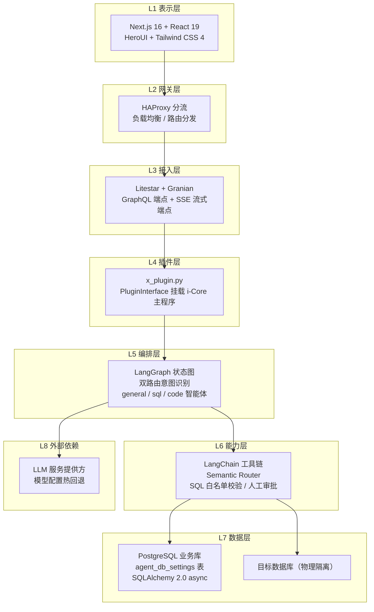
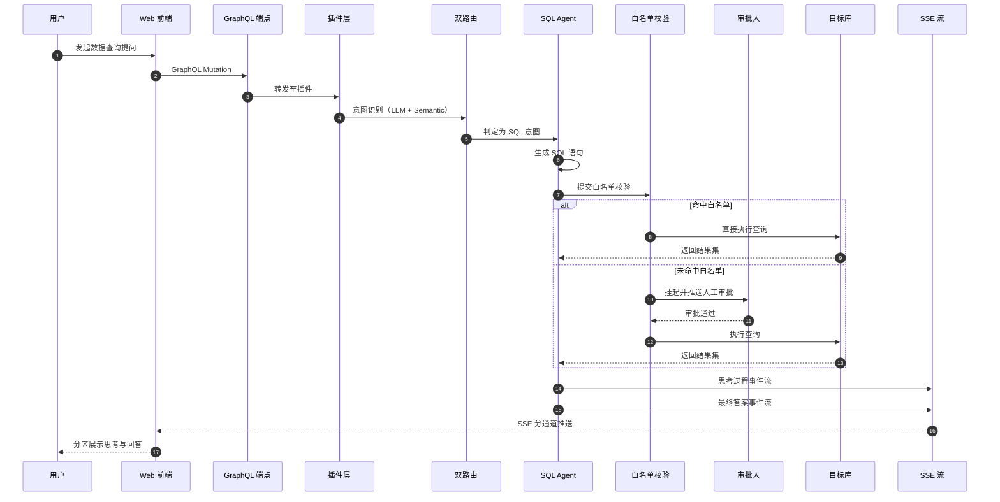

<div align="center">

# id_x_010: 通用计算智能体

**科研级知识库与数据查询的多智能体编排引擎 —— 让每一次提问都有迹可循**


</div>

---

## 1. 简介 (Introduction)

**面向科研级知识库与数据查询的 LangGraph 智能体编排插件**

id_x_010（通用计算智能体）是一个基于状态图的多智能体编排与对话服务插件。它通过 PluginInterface 挂载到 i-Core 主程序，对外暴露 GraphQL + SSE 流式端点，内置 general / sql / code 三类智能体与双路由意图识别机制，支持多轮上下文固化、思考过程分离流式输出、SQL 安全白名单与人工审批，为科研场景下的知识问答与数据查询提供安全、可观测、可扩展的智能体服务。

## 2. 核心特性 (Features)

- **多智能体编排**：基于 LangGraph 状态图编排 general / sql / code 三类智能体，按意图动态调度
- **双路由意图识别**：LLM 推理路由与 Semantic Router 语义路由双重判定，兼顾准确率与响应速度
- **SQL 安全白名单 + 人工审批**：SQL Agent 仅允许白名单内操作，高风险语句强制进入人工审批流程
- **GraphQL + SSE 双通道**：查询变更走 GraphQL，流式输出走 SSE，思考过程与最终答案分离推送
- **模型配置热回退**：模型配置支持热更新与失败自动回退，保障对话服务持续可用

## 3. 项目亮点 (Highlights)

1. **状态图驱动的多智能体编排**：以 LangGraph 状态图为核心，将意图识别、智能体调度、工具调用、结果汇总统一建模为可观测、可回放的状态流转
2. **双路由意图识别机制**：Semantic Router 毫秒级命中高频意图，LLM 路由兜底长尾问题，两层路由协同降低误判率
3. **SQL 安全白名单与人工审批闭环**：SQL 语句执行前经过白名单静态校验，越权或高危操作自动挂起并推送审批，审批通过后方可执行
4. **目标库与业务库物理隔离**：SQL Agent 查询的目标数据库与插件业务库物理隔离，目标库连接配置统一存放于 agent_db_settings 表，杜绝越库访问
5. **多轮上下文固化**：对话上下文在状态图中显式固化，跨轮次引用、指代消解与长对话一致性得到可靠保障
6. **思考过程分离流**：推理链路与最终答案通过独立 SSE 事件流推送，前端可分区域展示"思考中"与"回答中"两种状态
7. **实例缓存避免重复构图**：智能体编排图按配置指纹缓存实例，配置未变更时直接复用，避免重复构建状态图带来的开销

## 4. 技术栈 (Tech Stack)

<p align="center">表 1：技术栈一览</p>

分类 | 名称 | 版本 | 用途
--- | --- | --- | ---
前端框架 | Next.js | 16.2.3 | Web 应用框架与服务端渲染
前端框架 | React | 19 | 用户界面构建
UI 组件 | HeroUI | - | 组件库与交互体系
样式方案 | Tailwind CSS | 4 | 原子化样式与主题定制
Web 框架 | Litestar | - | 后端 ASGI 应用框架
运行时 | Granian | - | 高性能 Rust ASGI 服务器
API 协议 | Strawberry GraphQL | - | GraphQL Schema 与解析器
智能编排 | LangGraph | - | 状态图多智能体编排
模型接入 | LangChain | - | LLM 调用与工具链封装
意图路由 | Semantic Router | - | 语义级意图快速匹配
ORM | SQLAlchemy | 2.0 (async) | 异步数据访问层
数据库 | PostgreSQL | - | 业务库与目标库存储
流量分发 | HAProxy | - | 网关分流与负载均衡

## 5. 整体架构图 (Overall Architecture Diagram)

<p align="center">图 1：八层整体架构</p>



## 6. 请求流转图 (Request Flow Diagram)

<p align="center">图 2：SQL 查询与人工审批流转</p>



## 7. 目录结构 (Directory Structure)

```text
id_x_010/
├── src/                        # 后端源码
│   ├── agents/                 # 智能体定义（general / sql / code）与状态图编排
│   ├── controllers/            # Litestar 控制器与 SSE 流式端点
│   ├── graphql/                # Strawberry GraphQL Schema 与解析器
│   ├── models/                 # SQLAlchemy 2.0 异步数据模型
│   ├── schemas/                # 请求 / 响应数据结构定义
│   ├── utils/                  # 工具函数（白名单校验、上下文固化等）
│   └── views/                  # 视图与模板
├── web/                        # 前端工程
│   ├── public/                 # 静态资源
│   └── src/                    # Next.js 16 + React 19 源码
│       ├── api/                # GraphQL / SSE 客户端封装
│       ├── app/                # App Router 页面
│       ├── components/         # 业务组件
│       ├── context/            # React Context
│       ├── hooks/              # 自定义 Hooks
│       ├── layout/             # 布局组件
│       ├── redux/              # 状态管理
│       ├── services/           # 业务服务层
│       ├── ui/                 # HeroUI 基础组件封装
│       ├── utils/              # 前端工具函数
│       └── views/              # 页面视图
├── ops/                        # 运维与部署
│   ├── compose.yaml            # 容器编排清单
│   ├── up.sh / down.sh         # 一键启停脚本
│   ├── haproxy.cfg             # HAProxy 分流配置
│   ├── init.sql                # 数据库初始化脚本
│   └── Dockerfile.service      # 服务镜像构建文件
├── docs/                       # 项目文档
├── x_plugin.py                 # PluginInterface 插件入口
├── requirements.txt            # Python 依赖清单
└── LICENSE                     # AGPL-3.0 许可证
```

## 8. API 接口文档 (API Documentation)

服务端点

- GraphQL：`POST /graphql`
- SSE 流式：`GET /sse/stream`

<p align="center">表 2：核心接口一览</p>

接口 | 类型 | 说明
--- | --- | ---
`sendMessage` | Mutation | 发送用户消息，创建对话任务
`createSession` | Mutation | 创建新会话并返回会话标识
`sessionHistory` | Query | 查询会话历史消息
`approveSql` | Mutation | 人工审批 SQL 执行请求
`agentSettings` | Query | 查询 SQL Agent 目标库配置
`/sse/stream` | SSE | 订阅思考过程与最终答案事件流

请求示例

```bash
# 发送消息（GraphQL Mutation）
curl -X POST http://localhost:8000/graphql \
  -H "Content-Type: application/json" \
  -d '{
    "query": "mutation { sendMessage(sessionId: \"s-001\", content: \"查询近三个月的实验数据\") { taskId status } }"
  }'
```

```bash
# 订阅流式输出（SSE，思考与答案分通道推送）
curl -N http://localhost:8000/sse/stream?taskId=t-001
```

```bash
# 人工审批 SQL（GraphQL Mutation）
curl -X POST http://localhost:8000/graphql \
  -H "Content-Type: application/json" \
  -d '{
    "query": "mutation { approveSql(taskId: \"t-001\", approved: true) { status } }"
  }'
```

## 9. 快速部署 (Quick Deploy)

环境要求

- Python 3.11+ 与 Node.js 20+
- PostgreSQL 14+（业务库与目标库实例）
- Docker 与 Docker Compose（容器化部署）

本地安装

```bash
# 安装后端依赖
pip install -r requirements.txt

# 安装前端依赖
cd web && npm install
```

初始化数据库

```bash
psql -U postgres -f ops/init.sql
```

本地运行

```bash
# 启动后端（Granian）
granian --interface asgi x_plugin:app

# 启动前端开发服务
cd web && npm run dev
```

容器化部署

```bash
# 一键启动全部服务（含 HAProxy 分流）
bash ops/up.sh

# 停止并清理
bash ops/down.sh
```

---

<div align="center">

Copyright © TorchLabs · Ray · Licensed under AGPL-3.0

</div>
