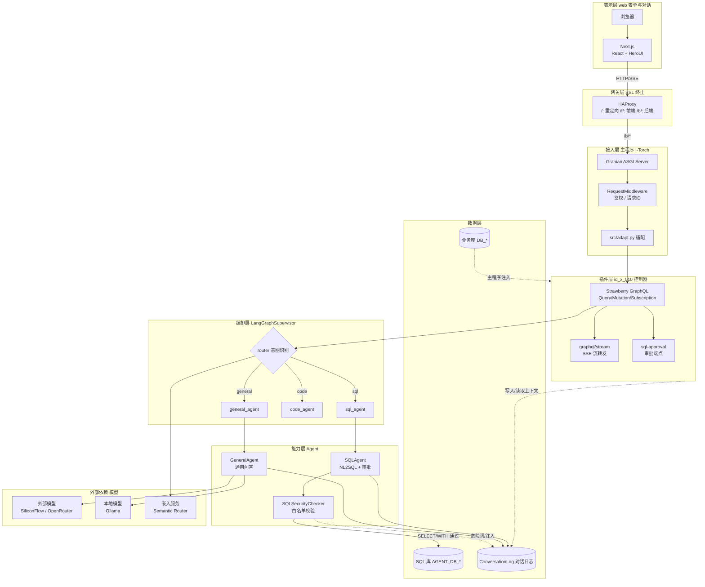
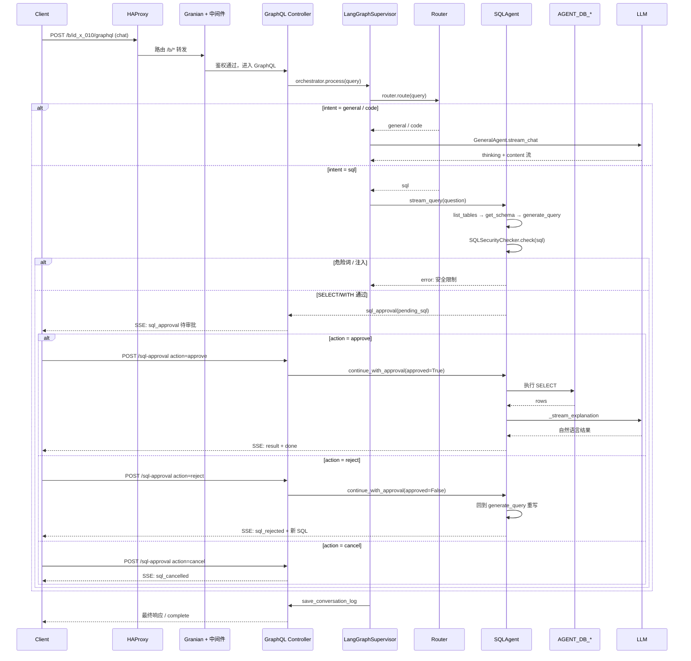

# id_x_010


---

## 1 项目简介

**Slogan**：面向企业级知识库与数据查询的智能体编排插件。

id_x_010 是 TorchLabs/i-Torch（id_x_000）主程序的智能体业务插件，定位为以 LangGraph 为核心的多智能体编排与对话服务。插件通过 `PluginInterface` 契约挂载到主程序，对外暴露 GraphQL 接口与 SSE 流式端点，对内编排 General、SQL、Code 三类 Agent，完成意图识别、自然语言转 SQL、安全审批、结果解释与流式回传的完整闭环。针对企业内部数据查询中的「模型选型混乱、SQL 注入风险、上下文断裂、流式体验差」等痛点，id_x_010 以统一的 Supervisor 状态图、白名单校验、人类审批节点与多轮上下文固化给出可复现方案，相较脚本式 LLM 调用具备更强的安全闭环与可维护性。

## 2 核心特性

- 多智能体编排：基于 LangGraph `StateGraph` 构建 `LangGraphSupervisor`，通过 `router` 节点分发至 `general_agent`、`sql_agent`、`code_agent`，节点命名与状态字段统一。
- 双路由层意图识别：提供 `SemanticRouter`（基于 Semantic Router 向量匹配）与 `LLMRouter`（基于结构化输出 `IntentResult`）两类路由器，可按场景切换。
- SQL 安全闭环：`SQLSecurityChecker` 白名单只放行 `SELECT`/`WITH`，对 `INSERT`/`DROP`/`TRUNCATE` 等 16 类危险关键字与注入模式拦截，并设 `human_approval` 节点等待人工批准。
- GraphQL + SSE 双通道：Strawberry 暴露 Query/Mutation/Subscription，`/graphql/stream` 以 Server-Sent Events（服务器发送事件, SSE）转发订阅，`/sql-approval` 单独承载审批流。
- 多轮上下文固库：对话以 `conversation_id` 关联，`ConversationLog` 落库后由 `merge_context` 合并历史与前端传入上下文，默认截断至最近 5 轮。

## 3 项目亮点

1. **意图双引擎可热切** —— `LLMRouter` 使用 `with_structured_output(IntentResult)` 强约束 LLM 给出 `intent/confidence/reasoning`，`SemanticRouter` 以嵌入向量匹配样例 utterances，`use_llm_router` 一参切换，路由失败统一回退 `general`。
2. **SQL 审批 human-in-the-loop** —— LangGraph 将 `human_approval` 设为节点而非边，`approval_status` 取 `approved/rejected/cancelled` 三态，拒绝后回到 `generate_query` 重写 SQL，取消则短路返回，形成可审计的人机协同链路。
3. **白名单 + 注入双检** —— `SQLSecurityChecker.check` 先正则提取首关键字再扫描 14 类危险词与 6 类注入模式（`;\\w+`、`--$`、`UNION SELECT` 等），非 `SELECT`/`WITH` 一律拒绝，将安全决策前置到执行前。
4. **DB 隔离连接** —— `DatabaseConnection` 使用 `AGENT_DB_*` 环境变量，与业务主库 `DB_*` 物理隔离，并通过 `pool_pre_ping`、独立 `create_async_engine` 防止 SQL Agent 慢查询拖垮主连接池。
5. **实例缓存降本** —— `get_supervisor`、`get_sql_agent` 以 `model_type/model_name/db_name` 为键缓存编译后的 StateGraph，避免每次请求重新构图与建连，相同参数命中缓存即复用。
6. **思考过程分离流** —— `StreamingHandler` 实时解析 `<thinking>...</thinking>` 标签，`thinking` 与 `content` 分通道输出，前端可独立渲染推理折叠区，不影响正文打字机效果。
7. **模型配置热回退** —— `get_external_model_config` 优先读数据库 `external_models` 表，失败时回退环境变量并标注「回退模式」，模型列表接口在 DB 不可用时仍可用。

## 4 技术栈

表 4-1 id_x_010 技术栈一览

| 分类 | 名称 | 版本 | 用途 |
|---|---|---|---|
| 编程语言 | Python | ≥ 3.10 | 服务端主语言 |
| 编程语言 | TypeScript | ≥ 5.0 | 前端主语言 |
| 后端框架 | Litestar | ≥ 2.24 | ASGI 路由与中间件宿主 |
| 接口协议 | Strawberry GraphQL | ≥ 0.323 | Query/Mutation/Subscription |
| 智能体编排 | LangGraph | ≥ 0.2 | StateGraph 工作流编排 |
| LLM 调用 | LangChain / langchain-openai | ≥ 0.3 | 模型抽象与工具绑定 |
| 语义路由 | Semantic Router | ≥ 0.1 | 向量意图识别 |
| 数据库 | PostgreSQL | ≥ 14 | 业务库与对话日志 |
| ORM | SQLAlchemy + asyncpg | ≥ 2.0 | 异步会话与连接池 |
| 前端框架 | Next.js | 16.2.3 | React 服务端渲染 |
| UI 组件 | HeroUI + Tailwind CSS | ^3.2 / ^4 | 组件库与样式 |
| 反向代理 | HAProxy | — | SSL 终止与 `/b`、`/f` 路由分区 |

## 5 整体架构图



图 5-1 id_x_010 分层架构图

## 6 请求流转图



图 6-1 id_x_010 请求流转图

## 7 目录结构

```text
id_x_010/
├── plugin.py                    # 插件入口: load_plugin() 返回 _Idx010Plugin
├── requirements.txt             # Python 依赖清单
├── LICENSE                      # AGPL-3.0
├── src/
│   ├── controllers/
│   │   └── x_controllers.py     # Strawberry Query/Mutation/Subscription + register_routers
│   ├── agents/
│   │   ├── x_langgraph_supervisor.py  # LangGraphSupervisor + SemanticRouter + LLMRouter
│   │   ├── x_sql_agent.py             # SQLAgent + SQLSecurityChecker + DatabaseConnection
│   │   └── x_general_agent.py         # GeneralAgent + StreamingHandler
│   ├── models/
│   │   └── x_models.py         # SQLAlchemy ORM: User/ConversationLog/ExternalModel 等
│   ├── schemas/
│   │   └── x_schemas.py        # Strawberry 类型: ChatInput/StreamChunkType/AuthResponseType
│   ├── views/
│   │   └── x_views.py          # 对话日志存取 + 上下文合并
│   └── graphql/
│       └── __init__.py         # GraphQL 包占位
├── web/                        # Next.js 前端
│   ├── package.json            # next 16.2.3 / react 19.2.4 / HeroUI
│   ├── next.config.ts
│   ├── tsconfig.json
│   ├── src/
│   │   ├── app/                # Next.js App Router 页面
│   │   ├── api/                # 前端 BFF 路由
│   │   ├── components/         # React 组件
│   │   ├── views/              # 视图组装
│   │   ├── services/           # GraphQL/SSE 客户端封装
│   │   ├── redux/              # 状态管理
│   │   ├── hooks/              # 自定义 Hook
│   │   ├── context/            # React Context
│   │   ├── ui/                 # 通用 UI
│   │   └── utils/              # 工具函数
│   └── public/                 # 静态资源
├── ops/
│   ├── init.sql                # PostgreSQL 建表与触发器脚本
│   ├── id_x_010_service.service      # 后端 systemd 单元
│   ├── id_x_010_web.service          # 前端 systemd 单元
│   └── id_x_010[HAProxy].conf        # HAProxy 反向代理配置
└── docs/
    ├── 架构描述.md              # 分层架构说明
    ├── 实现要求.md              # 需求与验收点
    └── intent-recognition-analysis.md  # 意图识别分析
```

## 8 API 接口文档

id_x_010 对外接口由 `register_routers` 统一注册至主程序 `/b/id_x_010` 前缀下，受主程序 `RequestMiddleware` 的 Bearer 鉴权保护（豁免路径除外）。下表汇总主要端点，详细字段以 Strawberry Schema 为准。

表 8-1 接口汇总

| 方法 | 路径 | 鉴权 | 说明 |
|---|---|---|---|
| POST | `/b/id_x_010/graphql` | Bearer | GraphQL 查询/变更主入口 |
| POST | `/b/id_x_010/graphql/stream` | Bearer | GraphQL Subscription 的 SSE 转发 |
| POST | `/b/id_x_010/sql-approval` | Bearer | SQL 审批流（approve/reject/cancel） |

### 8.1 GraphQL Query

- `health`：健康检查，返回 `{ status: "ok", service: "id_x_010" }`。
- `getModels`：获取模型列表，优先查 `external_models`/`local_models` 表，失败回退环境变量 `EXTERNAL_BASE_URL`、`LOCAL_MODEL_BASE_URL`。
- `getDatabases`：从 `AGENT_DB_LIST` 解析可用数据库，支持 JSON 与逗号分隔两种格式。

### 8.2 GraphQL Mutation

- `chat(input: ChatInput!)`：非流式聊天。`ChatInput` 含 `query`、`model_type`（local/external）、`model_name`、`agent_type`（general/sql/code）、`conversation_id`、`db_name` 等字段，返回 `ChatResponseType{ response, thinking, conversation_id, model_used, success }`。
- `login`/`register`/`logout`/`forgotPassword`：账户体系，令牌入库 `user_tokens`，24 小时过期。

### 8.3 GraphQL Subscription

- `streamChat`：流式聊天，通过 `/graphql/stream` 端点以 SSE 推送 `StreamChunkType`，`type` 枚举：`intent`、`thinking`、`content`、`sql_approval`、`sql_rejected`、`result`、`done`、`error`。

### 8.4 SQL 审批

`/sql-approval` 端点接收 JSON 体，`action` 取值 `approve` / `reject` / `cancel`。批准后执行 SQL 并流式回传结果；拒绝则回到 `generate_query` 节点重写 SQL；取消则返回 `sql_cancelled` 短路结束。

### 8.5 调用示例

以下示例需替换占位符 `<BASE_URL>`、`<TOKEN>`。

```bash
# 非流式聊天
curl -X POST "<BASE_URL>/b/id_x_010/graphql" \
  -H "Authorization: Bearer <TOKEN>" \
  -H "Content-Type: application/json" \
  -d '{
    "query": "mutation { chat(input: { query: \"统计 users 表记录数\", modelType: \"external\", agentType: \"sql\" }) { response thinking conversationId modelUsed success } }"
  }'

# SSE 流式订阅
curl -N -X POST "<BASE_URL>/b/id_x_010/graphql/stream" \
  -H "Authorization: Bearer <TOKEN>" \
  -H "Content-Type: application/json" \
  -d '{
    "query": "subscription { streamChat(query: \"列出所有表\", modelType: \"external\") { type content sql conversationId modelUsed } }"
  }'

# SQL 审批
curl -X POST "<BASE_URL>/b/id_x_010/sql-approval" \
  -H "Authorization: Bearer <TOKEN>" \
  -H "Content-Type: application/json" \
  -d '{
    "conversation_id": "conv-abc",
    "sql": "SELECT count(*) FROM users;",
    "action": "approve",
    "question": "统计 users 表记录数",
    "model_type": "external"
  }'
```

未携带合法 Bearer Token 时由主程序中间件返回：

```json
{"error": "Unauthorized access", "code": 401}
```

请求体大小上限由主程序 `[BASE].MAX_REQUEST_BODY_SIZE` 控制，默认 1 073 741 824 字节（1 GiB）。

## 9 快速部署

### 9.1 环境准备

- Python ≥ 3.10（推荐 3.10）
- Node.js ≥ 20（前端构建，Next.js 16 建议 Node 20+）
- PostgreSQL ≥ 14（业务库与对话日志库，可分离部署）
- 主程序 i-Torch（id_x_000）已就绪并配置 `AGENT_DB_*` 凭据

### 9.2 安装

```bash
# 在主程序 x_models/ 下放置插件
cp -r id_x_010 <ID_X_000>/x_models/

# 安装 Python 依赖（建议使用主程序虚拟环境）
pip install -r x_models/id_x_010/requirements.txt

# 前端依赖
cd x_models/id_x_010/web
cnpm install
```

在主程序 `config/base_config.toml` 注册插件：

```toml
[EXTEND]
MODELS = [
    ["id_x_010", "/id_x_010"],
]
```

### 9.3 配置

初始化业务库表结构（替换连接参数）：

```bash
psql -h 127.0.0.1 -p 15432 -U postgres -d id_x_010 \
  -f x_models/id_x_010/ops/init.sql
```

在主程序 `.env` 或模块 `x_models/id_x_010/.env` 中配置 SQL Agent 目标库（与业务库隔离）：

```bash
AGENT_DB_HOST_ENC=<加密后主机>
AGENT_DB_PORT_ENC=<加密后端口>
AGENT_DB_NAME_ENC=<加密后库名>
AGENT_DB_USERNAME_ENC=<加密后用户>
AGENT_DB_PASSWORD_ENC=<加密后密码>
AGENT_DB_LIST=primary,analytics
```

加密使用主程序 `utils/encrypt_util.py`。前端环境变量写入 `web/.env.local`，至少包含 `NEXT_PUBLIC_API_BASE`。

### 9.4 运行

```bash
# 启动后端（在主程序根目录）
python main.py

# 启动前端
cd x_models/id_x_010/web
cnpm run dev      # 开发模式
# 或
cnpm run build && cnpm run start   # 生产模式
```

后端默认监听主程序配置端口（如 `0.0.0.0:8000`），前端 Next.js 默认监听 `3000`。生产环境通过 HAProxy 将 `/b/*` 路由到后端、`/f/*` 与 `/_next/*` 路由到前端，配置见 `ops/id_x_010[HAProxy].conf`。

### 9.5 容器部署（可选）

项目当前未内置 Dockerfile，可参考以下方式构建（以 Podman 为例，Docker 同理）：

```bash
cat > Dockerfile <<'EOF'
FROM python:3.10-slim
WORKDIR /app
COPY requirements.txt .
RUN pip install --no-cache-dir -r requirements.txt
COPY . .
CMD ["python", "../../main.py"]
EOF

podman build -t id_x_010:latest .
podman run -d --name id_x_010 -p 8000:8000 \
  --env-file .env id_x_010:latest
```

若使用 systemd 裸机部署，已提供单元文件：

```bash
sudo cp ops/id_x_010_service.service /etc/systemd/system/
sudo cp ops/id_x_010_web.service /etc/systemd/system/
sudo systemctl daemon-reload
sudo systemctl enable --now id_x_010_service.service
sudo systemctl enable --now id_x_010_web.service
```

若使用 Kubernetes，可用 `kubectl` 部署：

```bash
kubectl apply -f ops/deployment.yaml
kubectl rollout status deployment/id_x_010
```

部署清单需自行补全数据库连接、卷挂载与 `.env` 的 Secret 映射。

---

## 参考文献

- [1] LangChain. LangGraph: Build multi-actor applications with LLMs[EB/OL]. https://langchain-ai.github.io/langgraph, 2025.
- [2] Strawberry GraphQL. Strawberry Framework Documentation[EB/OL]. https://strawberry.rocks, 2025.
- [3] Litestar Project. Litestar Framework Documentation[EB/OL]. https://docs.litestar.dev, 2025.
- [4] Vercel. Next.js Documentation[EB/OL]. https://nextjs.org/docs, 2025.
- [5] Semantic Router. Semantic Router Documentation[EB/OL]. https://github.com/aurelio-labs/semantic-router, 2025.
