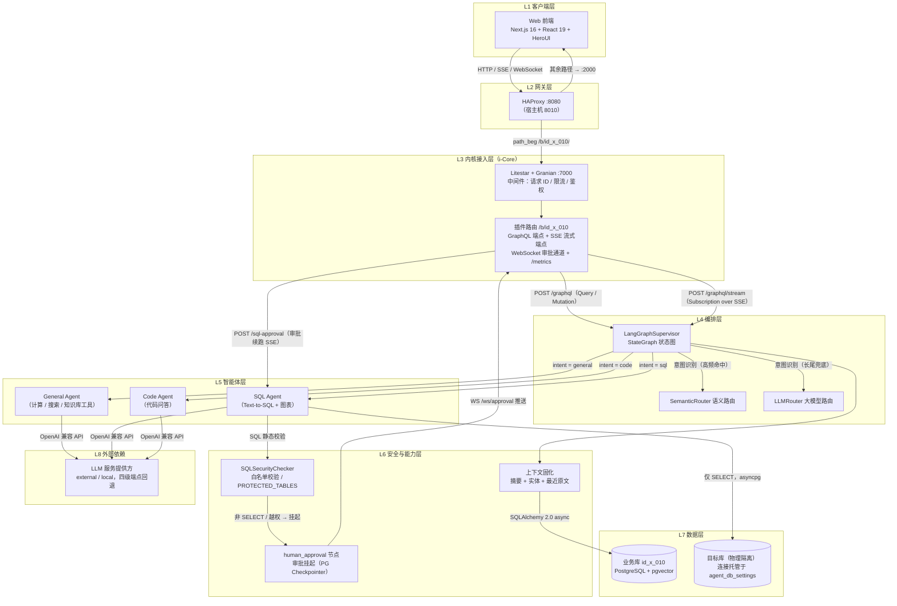
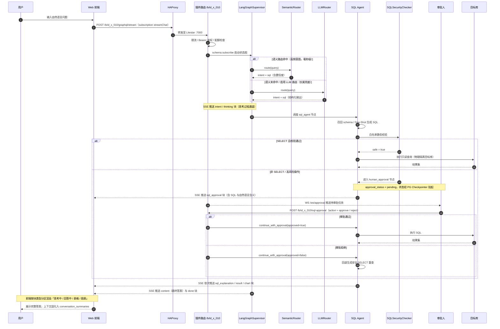

<div align="center">

# id_x_010: AI 通用计算智能体

**以问代查的多智能体编排引擎 —— 基于 LangGraph 状态图调度 general / sql / code 三类智能体，让每一次提问都有迹可循**


</div>

---

## 1. 简介 (Introduction)

- **Slogan**: 以问代查 —— 自然语言即查询语言，意图路由、SQL 安全校验与人工审批全程在状态图中显式可观测。
- **Description**: id_x_010（AI 通用计算智能体）是 **i-Core 平台**的业务插件模块，通过 `x_plugin.py` 暴露的 `PluginInterface` 契约挂载至 i-Core 内核（ORM 元数据注册、会话工厂注入、pgvector 扩展声明与建表均由内核托管）。模块以 **LangGraph 状态图**为核心编排 general / sql / code 三类智能体，采用「Semantic Router 语义路由毫秒级命中高频意图 + 大模型路由兜底长尾」的双路由意图识别机制；SQL 智能体内置白名单静态校验（`SQLSecurityChecker` + `PROTECTED_TABLES`），非 SELECT 等高风险操作自动挂起进入 `human_approval` 节点并经 WebSocket 推送人工审批；查询目标库（`agent_db_settings` 表托管连接）与插件业务库物理隔离。对外提供 **GraphQL + SSE 双通道**：查询变更走 GraphQL，思考过程（thinking）与最终答案（content）经 SSE 分离流式推送，多轮上下文通过「摘要 + 实体 + 最近原文」固化（`conversation_summaries`）。LLM 经 LangChain 接入，模型配置支持热更新与失败自动回退；前端为 Next.js 16 + React 19 + HeroUI，入口由 HAProxy 统一分流。适用于科研级知识库问答与业务数据查询场景，相比通用 Text-to-SQL 方案，差异在于「安全闭环 + 过程可观测 + 平台插件化」三位一体。

## 2. 核心特性 (Features)

- **多智能体状态图编排**：基于 LangGraph `StateGraph` 调度 general / sql / code 三类智能体节点，意图识别、节点流转、工具调用与结果汇总统一建模，审批挂起状态经 `langgraph-checkpoint-postgres` 跨进程持久化。
- **双路由意图识别**：`SemanticRouter`（semantic_router 0.1.x + OpenAIEncoder 向量语料）毫秒级命中高频意图，`LLMRouter` 结构化输出兜底长尾问题，路由器不可用时降级 general 保证主链路可用。
- **SQL 白名单校验与人工审批闭环**：`SQLSecurityChecker` 静态校验首关键字、危险模式、`pg_catalog` / `information_schema` 视图白名单与受保护表；非 SELECT 操作进入 `human_approval` 节点挂起，经 `/ws/approval` WebSocket 推送审批，审批通过后方可执行。
- **GraphQL + SSE 双通道流式输出**：18 个 Query、41 个 Mutation 走 `/graphql`；`stream_chat` Subscription 经 `POST /graphql/stream` 以 `text/event-stream` 推送，thinking / content / sql_approval / result / chart / done 等 15 种块类型分离呈现。
- **目标库与业务库物理隔离**：SQL 智能体查询的目标库连接统一存放于 `agent_db_settings` 表，与插件业务库（`DB_NAME=id_x_010`）各自独立建连，杜绝越库访问。

## 3. 项目亮点 (Highlights)

1. **安全纵深的 Text-to-SQL 执行链** —— 生成 SQL 后依次经过：首关键字白名单（仅 SELECT 直通）→ 危险模式检测 → `PROTECTED_TABLES` 受保护表/列拒绝（支持 `SQL_AGENT_PROTECTED_TABLES` 环境变量扩展）→ `information_schema` 结构性视图白名单放行 → 人工审批兜底，与 prompt 层表名过滤形成双保险。
2. **双路由协同的意图识别** —— 语义路由承担高频意图的毫秒级匹配（general / sql / code 三组语料），LLM 路由以 Pydantic 结构化输出兜底，JSON 解析失败时还有关键词启发式三级降级，误判率与时延同时收敛。
3. **插件化零侵入接入** —— 仅实现 `PluginInterface`（`base` / `set_session_maker` / `required_extensions` / `build_tables`）与 `register_routers(prefix)` 即挂载至 i-Core 内核，内核不感知插件内部包结构；pgvector 扩展缺失时 embedding 列自动降级 JSON 建表，应用启动不被阻塞。
4. **思考与答案分离的流式体验** —— 推理链路（thinking）与最终答案（content）以独立 SSE 块类型推送，前端可分区渲染「思考中 / 回答中」；SQL 审批面板、结果表格、图表配置（chart_config）均为独立块类型。
5. **实例缓存避免重复构图** —— Supervisor 按「模型 + 端点」指纹缓存，SQLAgent 连接按配置缓存（`_sql_agent_cache`），配置未变更时复用已编译状态图，省去每请求的 Agent 实例化 / workflow 编译 / PG checkpointer 探测开销。
6. **多轮上下文固化** —— 长期记忆以「会话摘要 + 实体 + 最近 6 条原文」组装（`conversation_summaries` 表），失败时回退全量截断合并，跨轮指代消解可靠。
7. **工程化治理完备** —— 限流（chat / stream_chat 20 次/分钟，登录 5 次/分钟）、bcrypt 密码哈希（sha256 存量自动升级）、按模型计价与月度配额（`model_prices` / `usage_logs` 分项计费）、Prometheus `/metrics` + OpenTelemetry trace、ruff + pre-commit 本地检查。
8. **模型配置热回退** —— 模型端点按「系统预置模型 → 用户自定义 Provider → 旧版单端点 → external_models 表」四级解析回退，管理员可热维护系统模型与价格，调用失败返回友好错误而非中断会话。

## 4. 技术栈 (Tech Stack)

<p align="center">表 4-1 技术栈一览</p>

| 分类 | 名称 | 版本 | 用途 |
|------|------|------|------|
| 编程语言 | Python / TypeScript | ≥ 3.10 / 5.x | 后端插件 / 前端工程 |
| 智能体编排 | LangGraph | — | 状态图多智能体编排与审批挂起 |
| 状态持久化 | langgraph-checkpoint-postgres | ≥ 1.0, < 4.0 | AsyncPostgresSaver 跨进程恢复审批状态 |
| 模型接入 | LangChain（langchain-openai 等） | — | LLM 调用、工具链与结构化输出 |
| 意图路由 | semantic_router | ≥ 0.1.0, < 0.2 | 语义级意图毫秒匹配（OpenAIEncoder） |
| Web 框架 | Litestar + Granian | — | ASGI 应用框架与高性能服务器（由 i-Core 内核托管，监听 7000） |
| API 协议 | Strawberry GraphQL | — | GraphQL Schema / Query / Mutation / Subscription |
| ORM | SQLAlchemy (async) + asyncpg | 2.0 | 业务库异步数据访问 |
| 数据库 | PostgreSQL + pgvector | pg18 镜像 | 业务库存储与向量检索（table_comments / document_chunks） |
| 前端框架 | Next.js / React | 16.2.3 / 19.2.4 | Web 应用框架与界面构建（dev 端口 2000） |
| UI 组件 | HeroUI (@heroui/react) | 3.2.2 | 组件库与交互体系 |
| 样式方案 | Tailwind CSS | 4 | 原子化样式 |
| 流量入口 | HAProxy | 3.0 | 网关分流（/b/id_x_010/ → 后端，其余 → 前端） |
| 可观测性 | prometheus-client / opentelemetry-sdk | ≥ 0.20 / ≥ 1.25 | /metrics 指标与 LangGraph trace |
| 容器部署 | Podman / podman-compose | — | 单 Pod 四容器一体化部署 |
| 代码质量 | ruff + pre-commit | — | 本地静态检查与提交钩子 |

## 5. 整体架构图 (Overall Architecture Diagram)



<p align="center">图 5-1 id_x_010 自上至下分层架构</p>

## 6. 请求流转图 (Request Flow Diagram)



<p align="center">图 6-1 一次流式查询（含意图路由与 SQL 审批分支）的完整生命周期</p>

## 7. 目录结构 (Directory Structure)

```text
id_x_010/
├── x_plugin.py                     # PluginInterface 插件入口（load_plugin / 建表 / pgvector 降级）
├── src/                            # 后端源码
│   ├── agents/                     # 智能体与编排
│   │   ├── x_langgraph_supervisor.py   # LangGraph 状态图编排 + 双路由意图识别
│   │   ├── x_sql_agent.py              # SQL Agent：白名单校验 / 审批挂起 / 图表生成
│   │   ├── x_general_agent.py          # General Agent（code_agent 复用本类）
│   │   ├── x_retriever_agent.py        # 向量检索召回（table_comments）
│   │   ├── x_vl_agent.py               # 视觉多模态 Agent（图片问答）
│   │   ├── x_llm_error.py              # LLM 错误友好化
│   │   └── tools/                      # ReAct 工具：计算 / 联网搜索 / 知识库 / 通知
│   ├── controllers/                # 接入层
│   │   ├── x_controllers.py            # GraphQL Schema、SSE 流式端点、路由注册
│   │   └── x_ws.py                     # WebSocket 审批通道（/ws/approval）
│   ├── views/                      # 业务视图层（x_views.py / x_approval.py）
│   ├── models/                     # SQLAlchemy 2.0 异步数据模型（26 张表）
│   ├── schemas/                    # Strawberry GraphQL 输入 / 输出类型
│   ├── middleware/                 # 管理员鉴权（x_admin）与限流（x_ratelimit）
│   ├── prompts/                    # 中英双语 Prompt 模板
│   └── utils/                      # 记忆固化 / 向量库 / 配额 / 计价 / 指标 / 导出等
├── web/                            # 前端工程（Next.js 16 + React 19 + HeroUI）
│   ├── src/
│   │   ├── views/                      # 页面视图（ChatHome / ApprovalCenter / AdminPanel 等）
│   │   ├── components/                 # 业务组件（审批面板 / 结果表格 / 图表视图等）
│   │   ├── api/ services/ hooks/       # GraphQL / SSE 客户端封装与业务服务
│   │   └── context/ redux/ layout/     # 主题、国际化、状态管理与布局
│   ├── Dockerfile                  # 前端镜像构建
│   └── .env.local.example          # 前端环境变量声明（NEXT_PUBLIC_*）
├── ops/                            # 运维与部署
│   ├── up.sh / down.sh                 # Podman 单 Pod 四容器一键启停
│   ├── compose.yaml                    # podman-compose 等价编排（含 prometheus）
│   ├── Dockerfile.service              # 后端镜像（以 i-Core 仓库根为构建上下文）
│   ├── haproxy.cfg / haproxy.compose.cfg   # 入口分流配置
│   ├── init/                           # 数据库初始化 SQL（01~08）
│   ├── prometheus.yml                  # 指标抓取配置
│   └── id_x_010_service.service / id_x_010_web.service   # systemd 单元（可选）
├── docs/                           # 架构描述 / 意图识别分析 / 实现要求等文档
├── .env.template                   # 模块环境变量模板（DB_* 加密项 / LLM_PROVIDER）
├── requirements.txt                # Python 依赖清单（覆盖引擎层依赖）
├── pyproject.toml                  # ruff 配置与工具元数据
├── .pre-commit-config.yaml         # 提交钩子
└── LICENSE                         # AGPL-3.0 许可证
```

## 8. API 接口文档 (API Documentation)

所有端点挂载于路由前缀 `/b/id_x_010`（由 i-Core 内核按 `config/base_config.toml` 的 `[EXTEND].MODELS` 声明注入）。鉴权采用 `Authorization: Bearer <TOKEN>` 请求头，token 由 `login` / `ssoLogin` Mutation 签发。

<p align="center">表 8-1 HTTP / WebSocket 端点汇总</p>

| 方法 | 路径 | 说明 |
|------|------|------|
| POST | `/b/id_x_010/graphql` | GraphQL 端点（18 Query / 41 Mutation） |
| POST | `/b/id_x_010/graphql/stream` | GraphQL Subscription over SSE（`text/event-stream`） |
| POST | `/b/id_x_010/sql-approval` | SQL 审批续跑（approve / reject / cancel，SSE 返回） |
| WS | `/b/id_x_010/ws/approval` | 审批任务实时推送通道（query string token 鉴权） |
| POST | `/b/id_x_010/upload-markdown` | 上传 Markdown 提示词文件 |
| POST | `/b/id_x_010/upload-avatar` | 上传用户头像 |
| POST | `/b/id_x_010/upload-image` | 上传图片（视觉多模态问答输入） |
| GET | `/b/id_x_010/avatar/{user_id}` | 读取用户头像 |
| GET | `/b/id_x_010/metrics` | Prometheus 指标（免鉴权，建议反向代理限源） |

### 8.1 GraphQL Query（18 个）

<p align="center">表 8-2 Query 一览</p>

| 操作名 | 鉴权 | 说明 |
|--------|------|------|
| `health` | 无 | 健康检查，返回 `{status, service}` |
| `getModels` | 可选 | 模型列表（系统预置 + 用户 Provider 合并去重） |
| `getDatabases` | 无 | 可查询目标库列表（读 `agent_db_settings`） |
| `getModelSettings` | Bearer | 当前用户模型设置 |
| `myModelProviders` | Bearer | 当前用户自定义模型 Provider 列表 |
| `listMarkdownPrompts` / `getActiveMarkdownPrompt` | Bearer | 提示词列表 / 当前选中提示词 |
| `usageStats` | Bearer | 用量统计（按日 + 按模型聚合，分项计费） |
| `listApprovalTasks` | Bearer | 待审批 SQL 任务（pending） |
| `listSqlExamples` | Bearer | SQL Few-Shot 例子（可按 db_name 过滤） |
| `mySystemModelKeys` | Bearer | 用户对系统模型的个人 API Key 映射 |
| `externalModels` | 无 | external_models 表记录（旧版兼容） |
| `systemModels` / `modelPrices` / `listUsers` / `adminUsageStats` / `listReportSubscriptions` / `adminListUserSystemModelKeys` | 管理员 | 系统模型 / 价格 / 用户 / 全局用量 / 报告订阅 / 用户 Key 管理 |

### 8.2 GraphQL Mutation（41 个，节选）

<p align="center">表 8-3 核心 Mutation 一览</p>

| 操作名 | 鉴权 | 说明 |
|--------|------|------|
| `chat` | 可选 | 非流式聊天（经编排器 process，返回 response + thinking） |
| `login` / `register` / `logout` / `forgotPassword` | 无 | 账号体系（bcrypt，登录限流 5 次/分钟） |
| `ssoLogin` | 无 | ADFS OAuth2 授权码 SSO，首次自动建档 |
| `sqlApproval` | Bearer | SQL 审批操作（GraphQL 形态；SSE 续跑走 `/sql-approval`） |
| `saveModelSettings` / `testModelConnection` | Bearer | 保存用户模型设置（保存前连通性检测） |
| `upsertUserModelProvider` / `deleteUserModelProvider` / `saveDefaultModel` | Bearer | 用户多 Provider 多模型管理 |
| `selectMarkdownPrompt` / `updateMarkdownContent` / `deleteMarkdownPrompt` / `renameMarkdownPrompt` | Bearer | Markdown 提示词管理 |
| `submitFeedback` | Bearer | 对话反馈（赞 / 踩 + 备注） |
| `exportSqlResult` | Bearer | 导出查询结果（≤ 1 万行，xlsx / csv，base64 同步返回） |
| `reindexSchema` | 管理员 | 重建目标库 schema 向量索引（写 `table_comments`） |
| `upsertSqlExample` / `deleteSqlExample` | 管理员 | Few-Shot 例子维护（自动生成 embedding） |
| `upsertSystemModel` / `deleteSystemModel` / `upsertModelPrice` / `deleteModelPrice` | 管理员 | 系统模型与计价维护（热更新） |
| `setUserAdmin` / `setUserActive` / `resetUserPassword` / `setUserQuota` | 管理员 | 用户治理与月度配额 |
| `savePromptTemplate` / `upsertReportSubscription` / `runSqlEval` | 管理员 | Prompt 版本 / 报告订阅 / SQL 评估 |

### 8.3 GraphQL Subscription（1 个）

- `streamChat(query, modelType, modelName, agentType, conversationId, context, dbName, promptDisabled)`：流式聊天。经 `POST /graphql/stream` 以 SSE 消费，产出 `StreamChunkType` 块，`type` 取值：`thinking` / `content` / `sql_generated` / `sql_explanation` / `sql_approval` / `sql_rejected` / `sql_cancelled` / `security_block` / `tool_call` / `result` / `chart` / `intent` / `start` / `done` / `error`；附带字段含 `sql`、`sql_meaning`、`columns`、`data`、`row_count`、`chart_config`、`security_block` 等。

### 8.4 调用示例

健康检查（GraphQL Query，将 `<BASE_URL>` 替换为入口地址，如 `http://localhost:8010`）：

```bash
curl -X POST <BASE_URL>/b/id_x_010/graphql \
  -H "Content-Type: application/json" \
  -d '{"query": "{ health { status service } }"}'
```

登录获取 token：

```bash
curl -X POST <BASE_URL>/b/id_x_010/graphql \
  -H "Content-Type: application/json" \
  -d '{"query": "mutation { login(input: {email: \"<EMAIL>\", password: \"<PASSWORD>\", role: \"user\"}) { success message token } }"}'
```

流式聊天（Subscription over SSE，`-N` 关闭缓冲；thinking 与 content 分块推送）：

```bash
curl -N -X POST <BASE_URL>/b/id_x_010/graphql/stream \
  -H "Content-Type: application/json" \
  -H "Authorization: Bearer <TOKEN>" \
  -d '{
    "query": "subscription { streamChat(query: \"统计近三个月各类别的数据量\", agentType: \"sql\", dbName: \"<DB_NAME>\") { type content sql sqlMeaning columns data rowCount } }"
  }'
```

SQL 人工审批（SSE 续跑；`action` 取 `approve` / `reject` / `cancel`）：

```bash
curl -N -X POST <BASE_URL>/b/id_x_010/sql-approval \
  -H "Content-Type: application/json" \
  -H "Authorization: Bearer <TOKEN>" \
  -d '{
    "conversation_id": "<CONVERSATION_ID>",
    "sql": "<PENDING_SQL>",
    "action": "approve",
    "question": "<ORIGINAL_QUESTION>",
    "db_name": "<DB_NAME>"
  }'
```

异常约定：GraphQL 业务错误统一以 `{success: false, message}` 返回；限流触发返回「请求过于频繁」提示（chat / streamChat 每分钟 20 次）；SSE 通道错误以 `type: "error"` 块或 `{"errors": [...]}` 事件下发；`/sql-approval` 非法 `action` 返回 HTTP 400。

## 9. 快速部署 (Quick Deploy)

### 9.1 环境准备 (Prerequisites)

- Python ≥ 3.10（容器镜像为 `python:3.10-slim`；本地开发建议 3.11）
- Node.js ≥ 20（前端 Next.js 16 构建）
- PostgreSQL 18 + pgvector 扩展（容器部署使用 `pgvector/pgvector:pg18` 镜像；扩展缺失时向量列自动降级 JSON）
- Podman 与 podman-compose（容器化部署）
- i-Core 主程序仓库（本模块为其插件，不可脱离内核独立运行）

### 9.2 安装 (Installation)

```bash
# 1. 在 i-Core 仓库根目录安装本模块依赖（覆盖引擎层依赖）
pip install -r x_models/id_x_010/requirements.txt

# 2. 在 config/base_config.toml 的 [EXTEND].MODELS 中声明模块挂载
#    MODELS = [ ["id_x_010", "/id_x_010"] ]  → 路由自动挂载于 /b/id_x_010

# 3. 配置模块环境变量（DB_* 加密项用主程序 utils/encrypt_util.py 生成）
cp x_models/id_x_010/.env.template x_models/id_x_010/.env

# 4. 安装前端依赖
cd x_models/id_x_010/web && npm install && cp .env.local.example .env.local
```

### 9.3 运行 (Run)

```bash
# 启动后端：在 i-Core 仓库根运行内核（Litestar + Granian，监听 7000）
#   内核自动装载插件、创建 vector 扩展、建表并注入会话工厂
python main.py

# 启动前端开发服务（端口 2000）
cd x_models/id_x_010/web && npm run dev

# 验证
curl -X POST http://127.0.0.1:7000/b/id_x_010/graphql \
  -H "Content-Type: application/json" \
  -d '{"query": "{ health { status } }"}'
```

### 9.4 容器部署 (Podman)

方式一：`up.sh` 单 Pod 四容器（db :5432→宿主机 54321 / service :7000 / web :2000 / haproxy :8080→宿主机 8010）：

```bash
cd x_models/id_x_010/ops
cp .env.example .env        # 设置 POSTGRES_PASSWORD 等必填项
bash up.sh                  # 首次构建镜像并启动（幂等）
bash up.sh --build          # 强制重建 service / web 镜像

bash down.sh                # 停止并移除容器与 Pod（保留镜像与数据卷）
bash down.sh --all          # 同时删除数据卷与镜像（完全清理）
```

方式二：podman-compose（额外含 prometheus :9090，与 up.sh 两套方式请勿混用）：

```bash
cd x_models/id_x_010/ops
podman-compose up -d --build
podman-compose down
```

启动后访问入口 `http://localhost:8010/`：HAProxy 将 `/b/id_x_010/` 前缀分流至后端 service，其余路径转发前端 web。数据库首次启动自动执行 `ops/init/` 下 01~08 初始化脚本；Prometheus 经 `/b/id_x_010/metrics` 抓取服务指标。

---

<div align="center">

Copyright © i-Core · X_Torch · Licensed under AGPL-3.0

</div>
