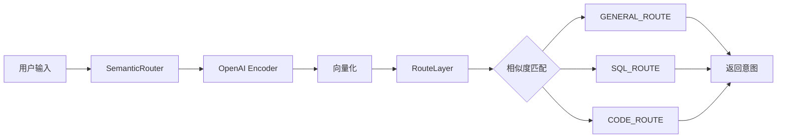
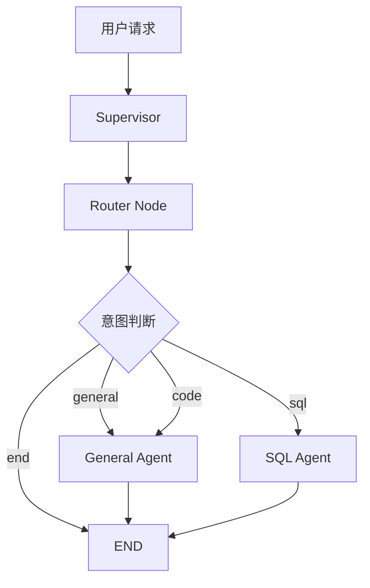
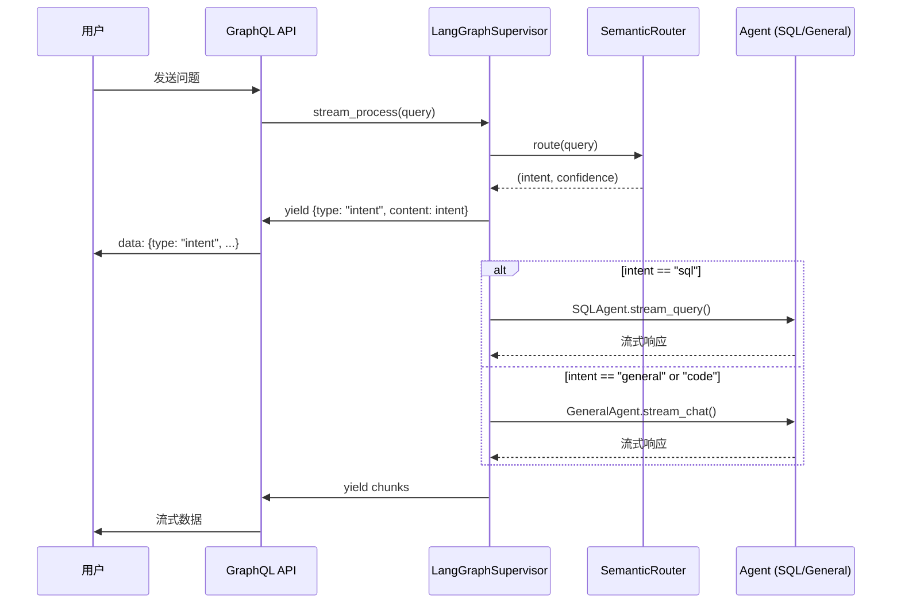
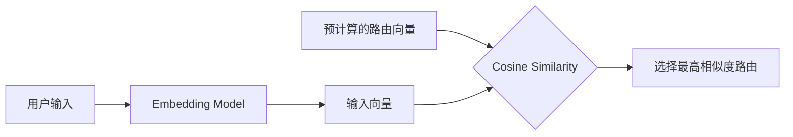
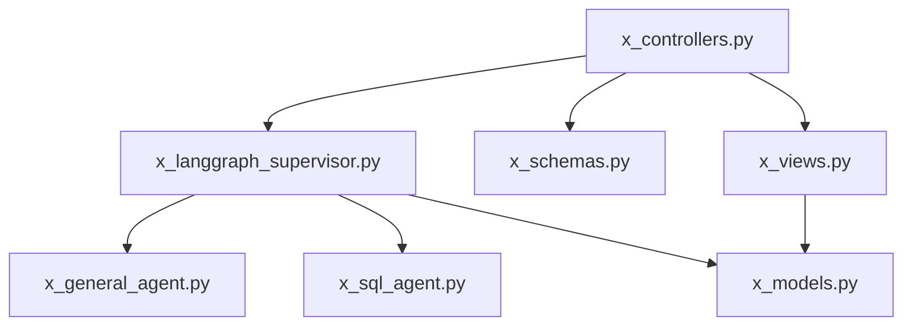
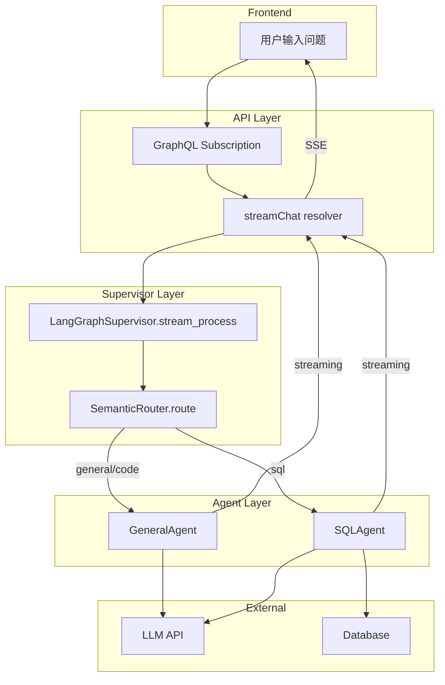

# 意图识别系统分析文档

> 本文档详细分析 `id_x_010` 项目中的用户意图识别逻辑和策略。

---

## 目录

1. [系统架构概览](#系统架构概览)
2. [核心组件详解](#核心组件详解)
3. [意图识别流程](#意图识别流程)
4. [路由策略详解](#路由策略详解)
5. [代码结构分析](#代码结构分析)
6. [数据流图](#数据流图)
7. [扩展与优化建议](#扩展与优化建议)

---

## 系统架构概览

### 项目目录结构

```
src/
├── agents/                          # 智能体模块
│   ├── x_langgraph_supervisor.py    # 主管程序 + 语义路由器（核心）
│   ├── x_general_agent.py           # 通用智能体
│   └── x_sql_agent.py               # SQL 智能体
├── controllers/                     # 控制器
│   └── x_controllers.py             # GraphQL 控制器
├── models/                          # 数据模型
│   └── x_models.py                  # 数据库模型
├── schemas/                         # 数据结构
│   └── x_schemas.py                 # GraphQL Schema 定义
└── views/                           # 业务视图
    └── x_views.py                   # 对话历史管理
```

### 架构设计理念

项目采用 **LangGraph Supervisor 模式**，实现了：

- **语义路由（Semantic Router）**：基于向量相似度的意图识别
- **多 Agent 协作**：根据意图分发到不同的专业 Agent
- **流式响应**：支持 SSE 流式输出
- **对话历史**：支持多轮对话上下文

---

## 核心组件详解

### 1. 路由规则定义（Route）

路由规则是意图识别的基础配置，定义了每个意图的触发条件。

#### GENERAL_ROUTE（一般性问题）

```python
GENERAL_ROUTE = Route(
    name="general",
    utterances=[
        # 问候语
        "你好", "你好吗",
        # 解释类
        "请帮我解释一下", "什么是", "如何理解",
        # 建议类
        "给出建议", "你觉得", "你认为",
        # 其他
        "请解释", "简单说明", "详细介绍",
        "帮我解答", "问个问题", "帮我翻译",
        "写一篇文章", "帮我作文", "聊天",
        "闲聊", "讲个笑话",
    ],
)
```

**适用场景**：
- 一般问答
- 知识解释
- 翻译、写作
- 闲聊对话

#### SQL_ROUTE（数据库查询）

```python
SQL_ROUTE = Route(
    name="sql",
    utterances=[
        # 数据库查询
        "查询数据库", "请查询数据库", "帮我查询数据库",
        "查询数据库中的数据", "从数据库查询", "数据库查询",
        
        # 统计相关
        "统计有多少", "统计数据库", "数据有多少条",
        "数据库中有多少", "有多少张表", "表中有多少数据",
        
        # 表操作
        "列出所有表", "显示所有表", "查看表结构",
        "获取表信息", "表结构是什么", "有哪些表",
        
        # SQL 相关
        "执行 SQL", "执行查询", "运行 SQL",
        "SQL 查询", "SELECT 查询",
        
        # 完整例句
        "帮我查一下数据库", "请问数据库中有多少数据",
        "我想查询数据库", "请告诉我数据库的情况",
    ],
)
```

**适用场景**：
- 数据库查询
- 数据统计分析
- 表结构探索
- SQL 执行

#### CODE_ROUTE（代码生成）

```python
CODE_ROUTE = Route(
    name="code",
    utterances=[
        # 代码编写
        "写一个脚本", "帮我写代码", "生成代码",
        "编写程序", "实现功能", "写一个函数",
        "创建一个类", "帮我编程", "生成脚本",
        
        # 编程相关
        "代码实现", "编程解决", "用 Python 写",
        "写一段代码", "写一个程序", "编程实现",
        "代码生成", "如何编程", "写个脚本",
    ],
)
```

**适用场景**：
- 代码生成
- 脚本编写
- 程序开发

---

### 2. SemanticRouter 类

语义路由器是意图识别的核心组件，使用 `semantic-router` 库实现基于向量相似度的意图匹配。



#### 初始化流程

```python
class SemanticRouter:
    def __init__(
        self,
        openai_api_key: Optional[str] = None,
        openai_base_url: Optional[str] = None,
        embedding_model: Optional[str] = None,
    ):
        # 1. 获取配置（优先级：参数 > 配置文件 > 环境变量）
        final_api_key = openai_api_key or external_config.get("api_key") or os.getenv("EXTERNAL_API_KEY")
        final_base_url = openai_base_url or external_config.get("base_url") or os.getenv("EXTERNAL_BASE_URL")
        final_embedding_model = embedding_model or os.getenv("EXTERNAL_EMBEDDING_MODEL", "Qwen/Qwen3-Embedding-8B")

        # 2. 创建编码器
        self.encoder = CustomOpenAIEncoder(
            name=final_embedding_model,
            openai_api_key=final_api_key,
            openai_base_url=final_base_url,
        )

        # 3. 创建路由层
        self.route_layer = RouteLayer(
            encoder=self.encoder,
            routes=[GENERAL_ROUTE, SQL_ROUTE, CODE_ROUTE],
        )
```

#### 核心方法：route()

```python
def route(self, query: str) -> Tuple[str, float]:
    """
    根据用户输入路由到合适的意图
    
    Args:
        query: 用户输入的问题
        
    Returns:
        Tuple[str, float]: (意图名称, 置信度分数)
    """
    try:
        # 调用 RouteLayer 进行意图识别
        route_result = self.route_layer(query)

        if route_result:
            if isinstance(route_result, list) and route_result:
                intent = getattr(route_result[0], "name", "general") or "general"
            else:
                intent = getattr(route_result, "name", "general") or "general"
            confidence = 0.8  # 默认置信度
            return intent, confidence
        else:
            # 未匹配时返回默认意图
            return "general", 0.5

    except Exception as e:
        # 异常时返回默认意图
        return "general", 0.0
```

#### 路由信息映射

```python
def get_route_info(self, intent: str) -> dict:
    """获取路由对应的详细信息"""
    route_info = {
        "general": {
            "description": "一般性问题和对话",
            "agent": "general_agent",
            "system_prompt": DEFAULT_SYSTEM_PROMPT,
        },
        "sql": {
            "description": "数据库查询相关",
            "agent": "sql_agent",
            "system_prompt": "你是一个数据库专家，帮助用户查询和分析数据。",
        },
        "code": {
            "description": "代码生成相关",
            "agent": "general_agent",  # 使用 general_agent 处理
            "system_prompt": "你是一个编程专家，帮助用户编写和调试代码。",
        },
    }
    return route_info.get(intent, route_info["general"])
```

---

### 3. LangGraphSupervisor 类

主管程序协调整个意图识别和处理流程。

#### 工作流架构



#### 工作流构建

```python
def _build_workflow(self) -> CompiledStateGraph:
    """构建 LangGraph 工作流"""
    workflow = StateGraph(SupervisorState)

    # 添加节点
    workflow.add_node("router", self._router_node)
    workflow.add_node("general_agent", self._general_agent_node)
    workflow.add_node("sql_agent", self._sql_agent_node)

    # 设置入口点
    workflow.set_entry_point("router")

    # 添加条件边：根据意图路由到不同的 agent
    workflow.add_conditional_edges(
        "router",
        self._decide_next_agent,
        {
            "general": "general_agent",
            "sql": "sql_agent",
            "code": "general_agent",
            "end": END,
        },
    )

    # agent 处理完后结束
    workflow.add_edge("general_agent", END)
    workflow.add_edge("sql_agent", END)

    return workflow.compile()
```

#### 路由节点实现

```python
async def _router_node(self, state: SupervisorState) -> dict:
    """
    路由节点：使用语义路由识别用户意图
    
    Args:
        state: 当前状态
        
    Returns:
        dict: 更新的状态
    """
    query = state.get("query", "")

    if not query:
        return {"error": "用户问题为空", "intent": "end"}

    try:
        # 执行意图识别
        intent, confidence = self.router.route(query)
        route_info = self.router.get_route_info(intent)
        target_agent = route_info.get("agent", "general_agent")

        logger.info(
            f"[语义路由] 用户输入: '{query[:100]}...' "
            f"-> 意图: '{intent}' -> 命中 Agent: '{target_agent}' (置信度: {confidence})"
        )

        return {
            "intent": intent,
            "confidence": confidence,
            "system_prompt": route_info.get("system_prompt", DEFAULT_SYSTEM_PROMPT),
        }
    except Exception as e:
        return {
            "error": f"路由失败: {str(e)}",
            "intent": "general",
            "confidence": 0.0,
        }
```

#### 下一步决策

```python
def _decide_next_agent(self, state: SupervisorState) -> str:
    """
    决定下一个要执行的 agent
    """
    intent = state.get("intent", "general") or "general"
    error = state.get("error")

    if error and intent == "end":
        return "end"

    return intent
```

---

## 意图识别流程

### 流式处理流程（stream_process）



### 流式处理代码

```python
async def stream_process(
    self,
    query: str,
    model_type: Optional[str] = None,
    model_name: Optional[str] = None,
    conversation_id: Optional[str] = None,
    context: Optional[List[Dict[str, str]]] = None,
):
    """
    流式处理用户请求
    """
    if not conversation_id:
        conversation_id = str(uuid.uuid4())

    # 1. 执行意图识别
    intent, confidence = self.router.route(query)
    route_info = self.router.get_route_info(intent)
    target_agent = route_info.get("agent", "general_agent")

    # 2. 输出意图识别结果
    yield {
        "type": "intent",
        "content": intent,
        "confidence": confidence,
        "conversation_id": conversation_id,
    }

    # 3. 根据意图选择 Agent 处理
    if intent == "sql":
        sql_agent = SQLAgent(model_type=model_type, model_name=model_name)
        async for chunk in sql_agent.stream_query(question=query):
            chunk["conversation_id"] = conversation_id
            yield chunk
    else:
        agent = GeneralAgent(model_type=model_type, model_name=model_name)
        async for chunk in agent.stream_chat(
            query=query,
            context=context,
            system_prompt=route_info.get("system_prompt", DEFAULT_SYSTEM_PROMPT),
        ):
            chunk["conversation_id"] = conversation_id
            yield chunk
```

---

## 路由策略详解

### 1. 向量相似度匹配策略

语义路由器使用 **向量嵌入 + 余弦相似度** 进行意图匹配：

1. **预处理**：将 `utterances` 中的示例语句转换为向量
2. **运行时**：将用户输入转换为向量
3. **匹配**：计算用户输入向量与各路由示例向量之间的相似度
4. **选择**：选择相似度最高的路由作为意图



### 2. 置信度策略

当前实现的置信度策略较为简单：

| 场景 | 置信度 | 说明 |
|------|--------|------|
| 成功匹配 | 0.8 | 匹配到任一路由 |
| 未匹配 | 0.5 | 默认返回 general |
| 异常 | 0.0 | 发生错误 |

### 3. 默认回退策略

当意图识别失败时，系统采用以下回退策略：

```
优先级：具体意图 > general > end
```

- 匹配失败 → 返回 `general` 意图
- 发生异常 → 返回 `general` 意图，置信度 0.0
- 用户问题为空 → 返回 `end`，终止处理

### 4. Agent 映射策略

| 意图 | 目标 Agent | 系统提示词 |
|------|-----------|-----------|
| `general` | GeneralAgent | DEFAULT_SYSTEM_PROMPT |
| `sql` | SQLAgent | "你是一个数据库专家..." |
| `code` | GeneralAgent | "你是一个编程专家..." |

> **注意**：`code` 意图目前使用 `GeneralAgent` 处理，后续可扩展为专门的 CodeAgent。

---

## 代码结构分析

### 文件依赖关系



### 状态定义（SupervisorState）

```python
class SupervisorState(TypedDict):
    """Supervisor 状态定义"""
    messages: Annotated[List[BaseMessage], add_messages]  # 消息列表
    query: str                                           # 用户问题
    intent: Optional[str]                                # 识别的意图
    confidence: Optional[float]                          # 置信度
    response: Optional[str]                              # 响应内容
    thinking: Optional[str]                              # 思考过程
    error: Optional[str]                                 # 错误信息
    conversation_id: str                                 # 会话 ID
    model_type: str                                      # 模型类型
    model_name: str                                      # 模型名称
    context: List[Dict[str, str]]                        # 对话上下文
    system_prompt: str                                   # 系统提示词
```

### GraphQL 响应类型

```python
@strawberry.type
class StreamChunkType:
    """流式响应块"""
    type: str                    # 块类型: intent, thinking, content, sql_generated, done, error
    content: Optional[str]       # 内容
    model_used: Optional[str]    # 使用的模型名称
    conversation_id: Optional[str]  # 会话 ID
```

---

## 数据流图

### 完整请求处理流程



### 意图识别数据流

```
用户输入: "数据库有多少张表"
    ↓
SemanticRouter.route()
    ↓
向量化 + 相似度匹配
    ↓
匹配结果: SQL_ROUTE (相似度最高)
    ↓
返回: ("sql", 0.8)
    ↓
输出: {type: "intent", content: "sql", confidence: 0.8}
    ↓
路由到: SQLAgent
```

---

## 扩展与优化建议

### 1. 扩展新意图

添加新意图只需三步：

```python
# 步骤 1: 定义新的 Route
NEW_ROUTE = Route(
    name="new_intent",
    utterances=[
        "示例语句1",
        "示例语句2",
        # ...更多示例
    ],
)

# 步骤 2: 在 SemanticRouter 初始化时添加
self.route_layer = RouteLayer(
    encoder=self.encoder,
    routes=[GENERAL_ROUTE, SQL_ROUTE, CODE_ROUTE, NEW_ROUTE],
)

# 步骤 3: 在 get_route_info 中添加映射
route_info = {
    # ...
    "new_intent": {
        "description": "新意图描述",
        "agent": "new_agent",
        "system_prompt": "专门的系统提示词",
    },
}
```

### 2. 优化置信度计算

当前置信度是固定的，可以优化为基于实际相似度分数：

```python
def route(self, query: str) -> Tuple[str, float]:
    try:
        route_result = self.route_layer(query)
        
        if route_result:
            # 获取实际相似度分数
            if hasattr(route_result, 'similarity_score'):
                confidence = route_result.similarity_score
            else:
                confidence = 0.8
            
            intent = getattr(route_result, "name", "general")
            return intent, confidence
        else:
            return "general", 0.3  # 降低默认置信度
            
    except Exception as e:
        return "general", 0.0
```

### 3. 多意图支持

某些查询可能涉及多个意图，可以扩展支持：

```python
def route_multi(self, query: str) -> List[Tuple[str, float]]:
    """返回多个可能的意图"""
    results = self.route_layer(query, top_k=3)
    return [(r.name, r.similarity_score) for r in results]
```

### 4. 意图阈值控制

添加阈值控制，避免低置信度匹配：

```python
INTENT_THRESHOLD = 0.6

def route(self, query: str) -> Tuple[str, float]:
    intent, confidence = self._do_route(query)
    
    if confidence < INTENT_THRESHOLD:
        # 低置信度时回退到 general
        return "general", confidence
    
    return intent, confidence
```

### 5. 添加专门的 CodeAgent

当前 `code` 意图使用 `GeneralAgent` 处理，可以创建专门的 `CodeAgent`：

```python
class CodeAgent:
    """代码生成代理"""
    
    async def stream_code(self, query: str, ...):
        # 专门的代码生成逻辑
        # 支持：代码补全、调试、解释等
        pass
```

---

## 附录

### 相关文件路径

| 文件 | 路径 | 说明 |
|------|------|------|
| 语义路由器 | `src/agents/x_langgraph_supervisor.py` | 意图识别核心 |
| 通用代理 | `src/agents/x_general_agent.py` | 处理一般问题 |
| SQL代理 | `src/agents/x_sql_agent.py` | 处理数据库查询 |
| GraphQL Schema | `src/schemas/x_schemas.py` | API 类型定义 |
| 业务视图 | `src/views/x_views.py` | 对话历史管理 |

### 依赖库

- `semantic-router`: 语义路由库
- `langgraph`: 工作流编排
- `langchain`: LLM 框架
- `strawberry-graphql`: GraphQL 实现

---

*文档生成时间: 2026-06-10*
